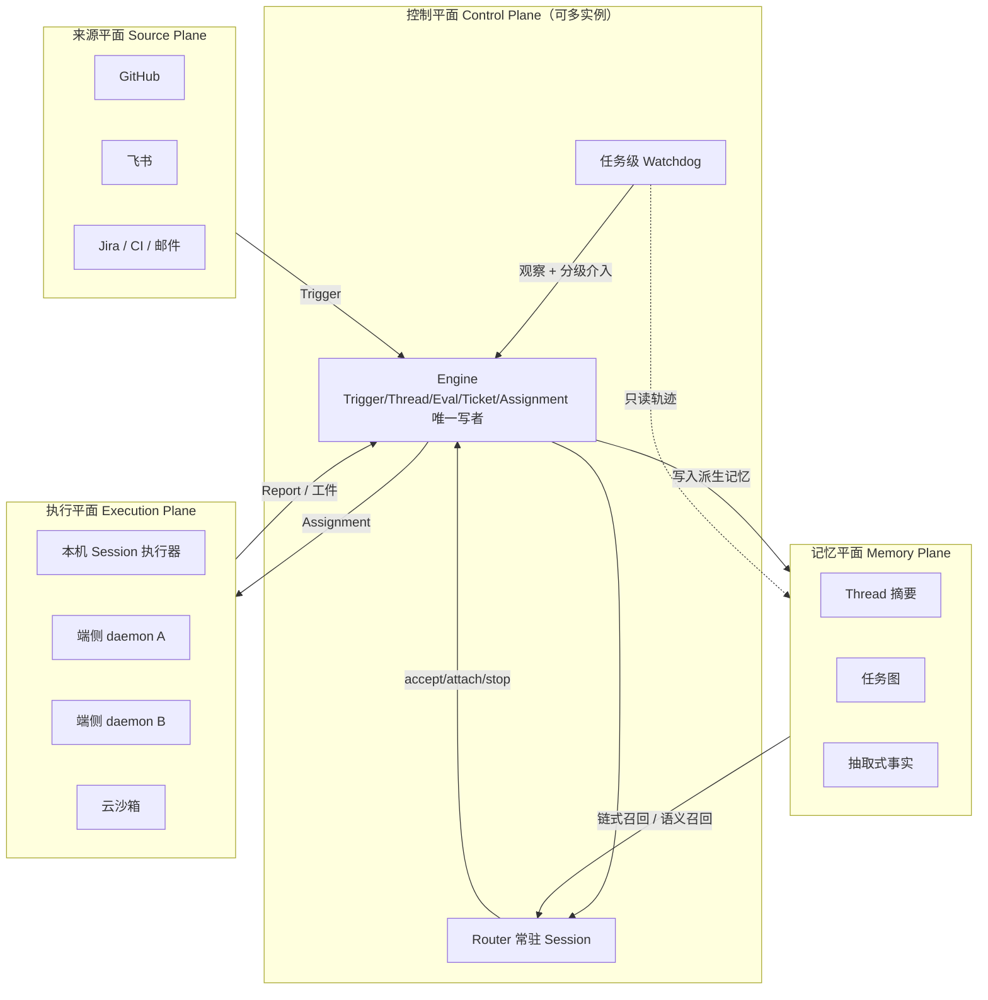
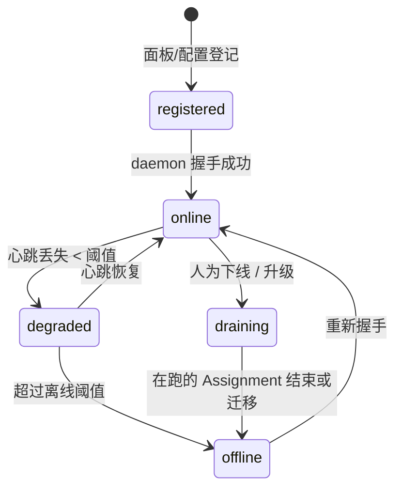
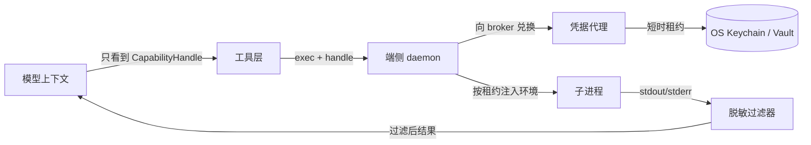
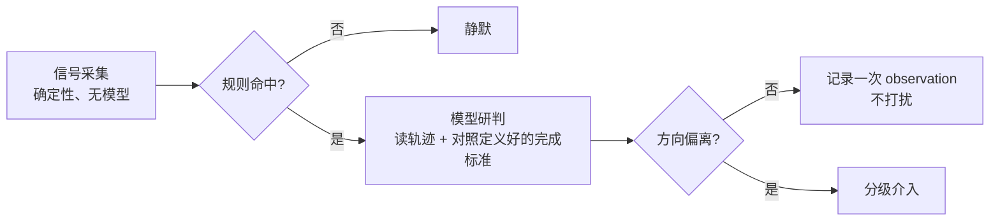
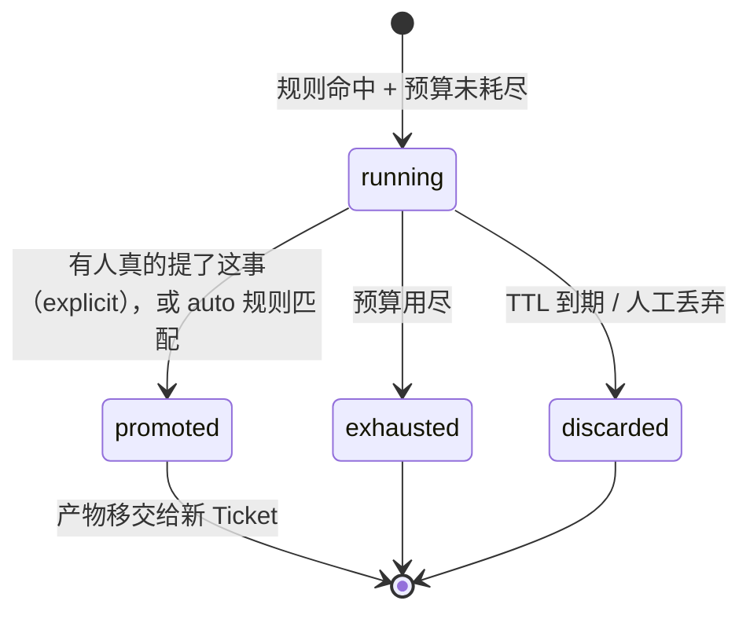
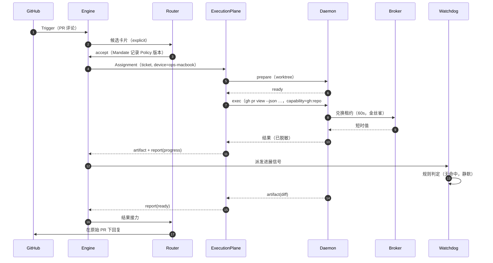

# 进一步设计

> 输入是 [00-official-notes.md](00-official-notes.md)（官方怎么做的）与 [10-gap-analysis.md](10-gap-analysis.md)（差在哪）。
> 本文给出一套在官方仓库之上继续演进的设计，包含分层、六个增强模块、接口草图、数据模型增量与拒绝项。

## 1. 设计目标与不变量

### 1.1 一句话目标

在不牺牲「授权可审计」与「Model-visible means logged」两条不变量的前提下，
把 Super-agent 从**单机单进程、单仓库、无凭据隔离、无进展感知**的原型，推进到**跨设备、多仓库、凭据不可达、能判断空转**的形态。

### 1.2 继承的四条不变量（不可协商）

| 不变量 | 含义 | 为什么不能动 |
| --- | --- | --- |
| I1 Model-visible means logged | 进过模型上下文的一切都能从 Session Log 重建 | 崩溃恢复、fork、遥测全靠这一份日志 |
| I2 权限由代码强制 | 消息与文档是输入，不能改变授权 | 常驻 Agent 最大的风险不是干不好，是被一句话指使干不该干的 |
| I3 单写者 | 每类状态只有一个写者 | 多实例、多设备下这是唯一能避免状态撕裂的办法 |
| I4 Stored work | 副作用先落库、提交后再执行 | 这是「重启后知道接着做哪一步」的前提 |

### 1.3 新增的三条不变量

| 不变量 | 含义 |
| --- | --- |
| I5 凭据不可达 | 模型上下文里不出现任何凭据原文；命令执行时的注入发生在模型看不到的一层 |
| I6 授权与执行解耦 | 「谁有权做」与「在哪台设备做」是两个独立维度，任何一台设备离线都不改变授权 |
| I7 进展可观测 | 一个 Ticket 的推进程度必须由外部可观测量（工件、副作用、状态转移）导出，不能只靠 Worker 自述 |

## 2. 总体分层

把原型的两层（Router / Worker）扩展为**四个平面**。关键认知：官方原型的 `src/core` 不做 I/O、只依赖 6 个 port，
这意味着**领域内核可以整块复用，只替换适配器**——这是本设计最重要的复用判断。



四条平面边界对应四条不变量：

- 控制平面**只做决策**，不做执行（对应原型 Router 不配写工具的取向）；
- 执行平面**只执行**，不持有会话状态（I1 的落实）；
- 记忆平面**只派生**，永不作为授权依据（I2 的落实）；
- 来源平面**只翻译**，不解释领域语义（沿用原型 Source 的定位）。

## 3. 六个增强模块

### 3.1 模块 E：执行平面抽象（Execution Plane）

**要解决的问题**：原型的 `DshExecutor` 把「在哪儿跑」写死成「操作员本机、一个 Ticket 一个目录、一条 prepare 命令」。
这带来三个后果：环境不可搬、设备离线即中断、单仓库假设。

#### 3.1.1 两种执行模式

| 模式 | Agent Loop 在哪 | 工具在哪 | 适用 |
| --- | --- | --- | --- |
| `local-session` | 与 Worker 同机 | 同机 | 原型现状；团队自己的开发机 |
| `remote-tools` | 云端（无状态） | 端侧 daemon | 长文 §5 的目标形态 |

`remote-tools` 是新增的关键能力：**把工具代理到端侧，而不是把 Session 搬过去**。
这样 Session Log、压缩、模型调用全在云端，只有 `bash` / `read` / `write` / `edit` / `glob` / `grep` 落到设备上。
好处是恢复语义与单机一致（Session 本来就持久），而执行环境不搬。

#### 3.1.2 端口设计

在原型 `ports.ts` 的 `Executor` 旁边增加一个更细的接口，`DshExecutor` 变成它的一个实现：

```ts
/** 执行平面：与原型 Executor 端口同构，但把「在哪跑」显式化。 */
export interface ExecutionPlane {
  /** 登记一台可作为执行目标的设备；返回稳定 id。 */
  register(device: DeviceDescriptor): DeviceId
  /** 为一台设备选择可用模式；离线设备仍返回绑定，只是当前不可调度。 */
  bind(device: DeviceId, mode: ExecutionMode): void
  /** 为一个 Ticket 解析应使用的设备：显式绑定 > 标签匹配 > 默认设备 > 排队。 */
  resolve(ticket: Ticket): DeviceId | undefined
  /** 以下四个与原型 Executor 端口同形，内部按模式分派。 */
  prepare(ticket: Ticket, outcome: AssessmentOutcome): Ticket
  start(assignment: Assignment): void
  deliver(ticketId: string, inputs: Input[]): void
  stop(ticketId: string): void
}

export interface DeviceDescriptor {
  readonly name: string            // 稳定、人类可读，如 "ops-macbook"
  readonly mode: ExecutionMode     // 'local-session' | 'remote-tools'
  /** 标签用于调度匹配：仓库、工具链、网络可达性。 */
  readonly labels: Readonly<Record<string, string>>
  /** 该设备上执行环境的根：workspace 建在这里。 */
  readonly workspaceRoot: string
  /** 凭据代理的标识（见 3.3），不是凭据本身。 */
  readonly credentialProfile: string
}

export type ExecutionMode = 'local-session' | 'remote-tools'
```

#### 3.1.3 设备状态机



**调度规则**（写进代码，不写进提示词——与官方「架构保证 > 提示词」的结论一致）：

1. 已在某设备上存在的 workspace 绑定优先（避免同一个 Ticket 换机器导致 worktree 丢失）；
2. 设备 `degraded` 时**允许继续**当前 turn，但**不允许新 launch**；
3. 设备 `offline` 时 launch 排队（`Working / queued`），不失败、不换设备；
4. 只有人显式「迁移到 B 设备」才改绑定，改绑定记一条 `ExecutionMigrated` 事实；
5. 迁移后新 Assignment 带一条恢复提示，复用原型 restart 的 `RESUMED` 文案。

#### 3.1.4 daemon 协议

传输层用 dsh 已依赖的 WebSocket（`dsh-host-webserver` 已支持 upgrade 路由），消息为 JSON-RPC 风格。
核心是**幂等 + 可重放**：每条请求带 `(ticketId, assignmentId, requestSeq)`，daemon 记录已执行的 `requestSeq`，
重连后从 `requestSeq+1` 重放。

```ts
// 控制面 → daemon
type ToDaemon =
  | { t: 'hello';   device: DeviceId; protocol: 1 }
  | { t: 'prepare'; ticketId: string; workspaceRoot: string; command: string | null; env: EnvLine[]; timeoutMs: number }
  | { t: 'exec';    ticketId: string; requestSeq: number; argv: string[]; cwd: string; timeoutMs: number;
                    capability: CapabilityHandle | null; stdin?: string }
  | { t: 'fs';      ticketId: string; requestSeq: number; op: 'read' | 'write' | 'edit' | 'glob' | 'grep'; args: unknown }
  | { t: 'cancel';  ticketId: string; requestSeq: number }
  | { t: 'probe';   ticketId: string }          // Watchdog 用：不打扰 Worker 的环境探针
  | { t: 'drain' }                              // 优雅下线

// daemon → 控制面
type FromDaemon =
  | { t: 'ready';   device: DeviceId; capabilities: string[]; clockSkewMs: number }
  | { t: 'result';  requestSeq: number; exitCode: number | null; stdout: string; stderr: string; truncated: boolean }
  | { t: 'artifact'; ticketId: string; kind: 'file' | 'diff' | 'pr'; ref: string; bytes: number }
  | { t: 'heartbeat'; at: string; load: { running: number; queued: number } }
  | { t: 'error';   requestSeq?: number; code: DaemonErrorCode; detail: string }
```

**离线语义**（长文 §5.2 的例子）：

- 云端 Agent 的**非环境步骤**照常推进（读 PR、写总结、回 IM）；
- **环境步骤**落到 `WaitingForDevice` 的 Input，入队不丢；
- 设备上线后 daemon 先发 `hello`，控制面把该设备上排队的 `requestSeq` 按序重放；
- 云端 Agent 在恢复提示里被告知「上次有 N 个步骤在这台设备上未确认，先核对再重复对外动作」——
  这正是长文强调的「上一条命令是否已经生效」。

#### 3.1.5 拒绝项

| 拒绝 | 理由 |
| --- | --- |
| 把整个 dsh Session 搬到 daemon 上跑 | Session 状态会分裂成两份，违反 I1；且 daemon 要背模型调用与压缩的复杂度 |
| 用 SSH 代替 daemon 协议 | 无幂等、无工件回传、无离线队列，重连后无法判断命令是否生效 |
| 自动把离线设备的 Ticket 迁到别的设备 | workspace 与未提交的本地修改不可搬（长文 §5.2 明确反对） |

---

### 3.2 模块 S：来源平面的多仓库与可插拔

原型的单仓库约束来自两处：GitHub Source 的配置只有 `owner/name`，以及 Executor 的 prepare 命令隐含单一 clone。

**改动**：

- `Source` 实例配置从「一个 Repository」改成「一组 Repository 绑定」；
- `Mandate` 增加 `repository` 字段（原型已有 `scope`，加一维即可），**范围不清时不得跨仓库**；
- `Ticket.follows` 已经是 Thread 列表，天然支持跨仓库 PR——只需 Source 层不再假设同仓库；
- Executor 的 workspace 绑定从「一个目录」变成「`workspaceRoot/<repo>/<ticket>`」，`prepare` 命令按 repo 取。

**不为多仓库新增领域概念**：沿用官方哲学「一个业务需求变成已有概念的属性，设计不为它新增概念」。

MCP 作为补充 Source/工具来源暂不纳入——原型的 Source 协议已经够用，引入 MCP 会扩大攻击面（见 §6）。

---

### 3.3 模块 C：凭据代理（Credential Broker）

**要解决的问题**：原型自认垫片不是安全边界，Worker 可以 `cat ~/.config/gh/hosts.yml`，
也可以 `env` 看任何没被显式删掉的变量。长文的判断是：不解决这条，Super-agent 只能在很小的可信范围内工作。

#### 3.3.1 三层结构



**核心是三条规则**：

1. **模型只看到句柄**。`CapabilityHandle` 是一个描述符：`{ id, kind: 'gh' | 'git' | 'lark', scope: 'repo:dsh-super-agent#write', expiresAt }`。
   句柄可以出现在模型上下文里，凭据原文永远不行。
2. **注入发生在子进程创建的一瞬间**。daemon 拿到句柄后向 broker 兑换一次性租约（默认 60 秒、单次命令有效），
   把值直接写进子进程环境，不落磁盘、不进日志、不返回给调用方。
3. **输出必须经过脱敏**。三条防线：已知 secret 的值精确匹配、高熵串（Entropy > 阈值 + 长度）模糊匹配、
   以及**金丝雀 token**——broker 每次租约生成一个随机金丝雀，若在 stdout 中出现就说明有泄漏，直接拦截并告警。

#### 3.3.2 与原型垫片的差别

| | 原型垫片 | 凭据代理 |
| --- | --- | --- |
| 选择账号 | `PATH` 最前面的包装脚本 | 句柄声明 + broker 兑换 |
| 凭据位置 | 操作员 home 下的 CLI 配置 | 不可从 Worker 文件系统读取 |
| 泄漏防护 | 无 | 精确匹配 + 熵检测 + 金丝雀 |
| 可撤销 | 删脚本 | 租约自动过期，句柄可吊销 |
| 审计 | 无 | 每次兑换记 `SecretLease{handle, command, at}` |

#### 3.3.3 边界诚实性

**这不是无敌的沙箱。** daemon 以操作员身份运行，恶意命令仍可能通过侧信道（时序、`/proc`、系统调用）拿到信息。
本设计的目标不是「抵御被攻破的 Agent」，而是：

- 让**正常执行路径**不产生凭据进上下文的机会（这是绝大多数真实事故的来源）；
- 让泄漏**可检测**（金丝雀）而不是无声无息；
- 让授权**可撤销**（租约过期）。

如果要抵御被攻破的 Agent，需要 OS 级隔离（独立账号 + 容器 + seccomp），列为可选加固，不在默认路径。

---

### 3.4 模块 W：任务级 Watchdog

**要解决的问题**：原型只有基础设施层的 `status` 脚本。长文承认这是五个模块里最难做对的，因为要先回答「什么叫有进展」。

#### 3.4.1 先回答「什么叫有进展」

**不能**用「Worker 说自己在进展」当证据（自述不可信、也无法验证）。本设计把进展定义为**四类外部可观测量**：

| 类别 | 信号 | 采集方式 |
| --- | --- | --- |
| 工件变化 | 文件被写、diff 变化、commit 产生、PR 被开/被改 | daemon 的 `artifact` 事件 + Source 的 PR 轮询 |
| 副作用 | 对外发言、状态转移（Report 六态）、Assignment 起止 | Engine 的领域事件 |
| 轨迹结构 | 重复编辑同一路径的计数、工具调用 n-gram 重复、无新信息的 read 循环 | Session Log 的事件流（不需要模型） |
| 资源曲线 | 每 Ticket 的 token 消耗、墙钟时间、工具调用次数 | Session stats |

**关键的组合判据**（这是本设计的核心发明点，写成一个可测试的谓词）：

```
stalled(ticket) :=
     wallClockSinceLastArtifact(ticket) > T_artifact
  && artifactsChanged(ticket) < N_min
  && turnEndedSinceLastArtifact(ticket) >= K_turns
  && (repeatEdits(ticket) >= R_edits || toolCallRepetition(ticket) >= R_calls || tokenSpendPerArtifact(ticket) > C_max)
```

四个条件必须**同时**成立才算空转——只满足一个的都是正常的长任务、正常的调查、正常的等待。
阈值随 Ticket 类型变化（文档类与代码类不同），存在 Policy 里而不是写死。

#### 3.4.2 两级判据（延续官方的 Fast/Slow Path 思路）



- **第一级（快）**：纯规则，零模型调用，每 30 秒跑一次。命中率天然低（这是设计目标，不是缺陷）。
- **第二级（慢）**：只有规则命中时才请模型看轨迹。看什么？
  **看 Ticket 的完成标准**——来自 `Mandate.scope` + Worker 在 `orchestrator_ack` 里承诺的「命名了对象与预期结果」。
  Watchdog 的问题不是「你在干什么」，而是「你承诺的结果，这条轨迹在靠近它吗」。

#### 3.4.3 介入阶梯（权限必须分级）

| 级别 | 动作 | 需要谁授权 | 审计 |
| --- | --- | --- | --- |
| L0 | 只记 `observation` | 无（默认） | 不打扰任何人 |
| L1 | `steer` 一条短消息（如「同一段已改 5 次，先说明剩余差异再动手」） | 部署配置开启 | 记 `intervention{L1}` |
| L2 | 要求 Worker 重述计划并暂停自动推进 | 部署配置开启 | 记 `intervention{L2}` |
| L3 | 停止 Assignment，把 Ticket 交给发起的会话 | 人的确认，或 `auto` 档 | 记 `intervention{L3}` |
| L4 | 修改主系统提示词 / 触发规则 | **永远需要人确认** | 记 prompt/settings 版本 |

**L4 是长文自己点出的新故障点**：「一旦 Watchdog 自己判错了，它有权改主系统的提示词，这是一个新的故障点。」
本设计把它降级为「提案 + 人审」，Watchdog 可以写提案，但提案要人点一下才生效。

#### 3.4.4 误报成本与反馈闭环

- Watchdog **不消耗 Worker 槽位**，它跑在独立的 Session 里（沿用原型「跑在操作员自己的 profile 里」的判断，理由同样是「必须能在主系统挂掉时跑」）；
- 每次 `intervention` 记录**结果**（Ticket 是否因此恢复推进），形成一个精确率指标；
- 精确率低于阈值时**自动降级**到只观察（这一条很重要：防止看门狗变成新的噪音源）；
- 「打扰预算」：每个 Ticket 最多 L1 两次、L2 一次，超过直接升级到人，不再自动尝试。

#### 3.4.5 拒绝项

| 拒绝 | 理由 |
| --- | --- |
| 用「进程存活」当进展判据 | 长文的核心论点：进程活着不等于任务在推进 |
| 用「Worker 自述有进展」当证据 | 不可验证，且空转的 Worker 最擅长说自己忙 |
| 从自由文本推断状态 | 沿用原型的「被拒绝的概念」：状态判断靠结构化字段 |
| 让 Watchdog 直接接管执行 | 它会变成第二个瓶颈和第二个故障点；它只观察与介入 |

---

### 3.5 模块 P：投机执行预算（Speculation）

**要解决的问题**：原型的 `observe` 模式解决的是上线路径（先看它想干什么），不是投机执行本身。
缺的是中间那档：**授权尚未确定时，用有限预算做不可逆性很低的前置工作**。

#### 3.5.1 三段式权限

保持原型的 `off / observe / auto` 不动，在**旁边**加一个正交的概念，而不是加第四档（避免破坏已有语义）：

```ts
export interface SpeculationScope {
  readonly id: string
  /** 允许的前置工作类型；都是可逆的。 */
  readonly allowed: ReadonlyArray<'reproduce' | 'locate' | 'draft-patch' | 'draft-reply' | 'collect-evidence'>
  /** 预算，超了立刻停，不管做没做完。 */
  readonly budget: { tokens: number; wallClockMs: number; toolCalls: number }
  /** 产物隔离：写到 scratch 目录，永不 push、永不发。 */
  readonly quarantine: true
  readonly expiresAt: string
}
```

`Speculation` 是一个独立聚合，不是 Ticket 的一种状态：

```ts
export interface Speculation {
  readonly id: string
  readonly ruleId: string          // 触发它的 Policy 规则
  readonly triggerIds: string[]    // 观察到的 Trigger 批次
  readonly scope: SpeculationScope
  /** 产物一律在隔离区，带哈希；模型只能通过 handle 读。 */
  readonly artifacts: ArtifactRef[]
  /** running → exhausted | discarded | promoted */
  readonly state: SpeculationState
  /** 提升成 Ticket 时，被哪张 Ticket 收养。 */
  readonly adoptedBy?: string
}
```

#### 3.5.2 生命周期



**关键设计**：

1. **产物永远隔离**。投机工作产生的 patch 只在 `scratch` 目录，不 push、不开 PR、不发消息。
   这是与 `auto` 模式最本质的区别——`auto` 会真的对外行动。
2. **提升是交接，不是复用**。当人真的提出请求时，正常流程建 Ticket，然后把隔离区产物**移动**给新 Ticket 的 workspace，
   Worker 开局带一条提示「已有先前准备，先核对再继续」。不把 Speculation 变成 Ticket 的一种状态，保持领域模型的干净。
3. **丢弃要便宜**。整个投机工作在一个临时目录 + 一个临时 Session，丢弃 = 删目录 + 取消 Session，不留痕。
4. **预算硬停**。预算是三重的（token / 墙钟 / 工具调用），任一超限立刻 `exhausted`。这是防止「投机变成长跑」的唯一可靠办法。
5. **可观测**：面板上能看到「本来可以做什么」——把长文里「群里还在讨论，修复 PR 已经提了」的爽感，
   降级为「群里还在讨论，修复方案已经准备好，人一点就能提」。**这更保守，但符合 I2。**

#### 3.5.3 与官方例子的差异（需要明说的取舍）

长文的例子是：确认问题存在且修复简单，就**直接提交 PR**，全程不打扰。
本设计**不默认这样做**，理由是：那需要一条 `auto` 级的、范围很窄的规则，等价于把「判断修复是否简单」的执行权交给模型。
我们提供两种部署档位：

| 档位 | 行为 | 适用 |
| --- | --- | --- |
| `speculate-only`（默认） | 只准备，不交付 | 任何团队的第一阶段 |
| `speculate-then-act` | 满足规则条件时自动从 Speculation 提升为 Ticket 并执行 | 团队写明了规则、且在一个可回滚的范围内 |

`speculate-then-act` 只有在 `Policy` 里显式开启才生效，且必须带上「可回滚」的约束（例如只允许开 PR，不允许 merge）。

---

### 3.6 模块 M：记忆分层与遗忘

**要解决的问题**：原型在存储层「只增不减」，在检索层只有链式召回（近期多跳）。长文把跨月长程记忆列为开放问题。

#### 3.6.1 四层

| 层 | 内容 | 写者 | 生命周期 | 检索 |
| --- | --- | --- | --- | --- |
| L0 工作记忆 | 当前 Session 窗口 | dsh 本身 | 轮次 | 直接 |
| L1 Thread 摘要 | 一条 Thread 的滚动摘要 + 决策日志 | Engine 派生 | 随 Thread | 链式召回（原型已有） |
| L2 任务图 | Ticket + 结论 + 工件 + 引用关系 | Engine 派生 | 90 天热、之后归档 | 图遍历 + 关键词 |
| L3 抽取事实 | 「谁负责什么」「这个仓库的约定」等 | 模型抽 + 人确认 | 带 TTL 与置信度 | 语义检索 |

#### 3.6.2 三条纪律

1. **记忆只派生，不权威**。任何记忆条目都带 `derivedFrom`（Session Log 的坐标），可以追溯到原始事件。
   授权永远回到 Policy + Mandate，**不允许「记忆说可以」**。
2. **写入走单写者**。L1/L2 由 Engine 在领域事件后派生（同事务写 `effect`，提交后落），L3 由模型提案但需要人确认或高置信度规则。
3. **遗忘是一等公民**。每层有自己的 TTL 与压缩策略；遗忘动作本身记一条 `memory/forgotten`，可审计。

#### 3.6.3 遗忘策略

| 触发 | 动作 |
| --- | --- |
| Thread 结束 + 90 天无活动 | L1 摘要保留，原始 Trigger 归档（冷存储），索引保留 |
| Ticket 结束 + 180 天 | L2 只保留结论与工件引用，丢掉中间轨迹 |
| L3 事实超过 TTL 或来源冲突 | 标记 `stale`，召回时降权，再次被确认则刷新 |
| 存储超预算 | 按「最后访问时间 × 层权重」逐出，绝不逐出被 pin 的（人显式保留的） |

**这条对原型是直接修补**：`docs/007` §Persistence 明说 `trigger` / `disposition` / `decision` 表无界增长。
本设计给出可执行的逐出策略，并保留「逐出也可审计」。

---

## 4. 六个模块如何落到 dsh 上

### 4.1 插件组合

沿用原型的 bundle 思路，但拆成更细的插件，每个增强模块是独立可选件：

| 插件 id | 提供 | 对应模块 |
| --- | --- | --- |
| `dsh-super-agent` | Engine + Runtime + 面板（沿用原型骨架） | 控制平面 |
| `dsh-super-agent/execution-plane` | `ExecutionPlane` 端口 + 设备注册 + 调度 | E |
| `dsh-super-agent/daemon-protocol` | WebSocket 路由 + 幂等重放 | E |
| `dsh-super-agent/credential-broker` | 句柄、租约、脱敏 | C |
| `dsh-super-agent/watchdog` | 信号采集 + 分级介入（独立 Session） | W |
| `dsh-super-agent/speculation` | 预算、隔离区、提升 | P |
| `dsh-super-agent/memory` | L1/L2/L3 + 遗忘 | M |

### 4.2 用到的 dsh 能力接缝

本机 dsh 为 `0.2.1-rc.5`，下面这些都是已经存在的公开接缝，不需要改运行时：

| 需要 | dsh 已提供 | 备注 |
| --- | --- | --- |
| 创建/恢复 Session、投递消息 | `dsh-agent` 的 `Agent.followup()` / `steer()` / `inject()` / `whenIdle()` | `inject` 不唤醒，正好用于 notice |
| 旁路拦截工具调用 | `ctx.tools.guard()`（单调拒绝）、`tools/pre-execute` waterfall | 用于凭据与危险命令拦截 |
| 工具结果后处理 | `tools/post-execute` | 用于脱敏过滤 |
| 后台作业 | `ctx.jobs`（`dsh-jobs`） | 原型已用于 Worker 的后台 shell |
| 子 Agent | `ctx.subagents`（`dsh-subagent`） | Worker 的子 Agent 跑 `standard` preset |
| 工具集差异化 | `@deepseek-ai/dsh-agent-preset` | 原型已用两个 preset 实现 Router/Worker 差异 |
| 定时驱动 | `dsh-schedule` | Watchdog 与每小时体检 |
| HTTP/WS 路由 | `dsh-host-webserver` | 管理 API 与 daemon 握手 |
| MCP | `dsh-mcp-client` | **本设计默认不用**，见 §6 |

### 4.3 事件契约增量

在原型 `DomainEvents`（`trigger.received` … `policy.changed`）之后追加，保持「过去式 = 事实」的命名：

```
device.registered / device.online / device.offline
execution.migrated
artifact.produced
speculation.started / speculation.exhausted / speculation.promoted / speculation.discarded
watchdog.observed / watchdog.intervened
memory.forgotten
```

### 4.4 数据模型增量

沿用原型「一个表一类聚合、生成列做索引」的做法，新增 8 张表：

| 表 | 聚合 | 关键列 | 写者 |
| --- | --- | --- | --- |
| `device` | 执行目标 | `name`（唯一）、`mode`、`labels`(json)、`workspace_root`、`credential_profile`、`state`（生成列：`online`） | ExecutionPlane |
| `workspace_binding` | Ticket ↔ 设备 ↔ 目录 | `ticket_id`、`device_id`、`directory`、`created_at`、`closed_at` | ExecutionPlane |
| `daemon_request` | 幂等重放 | `(ticket_id, assignment_id, request_seq)` 唯一、`kind`、`result`、`at` | DaemonProtocol |
| `secret_lease` | 凭据租约审计 | `handle_id`、`command`、`canary`、`issued_at`、`expires_at` | CredentialBroker |
| `speculation` | 投机 | `rule_id`、`trigger_ids`、`budget`(json)、`state`、`adopted_by` | Speculation |
| `artifact` | 产物引用 | `ticket_id`、`speculation_id`、`kind`、`ref`、`sha256`、`bytes` | ExecutionPlane |
| `watchdog_observation` | 观察记录 | `ticket_id`、`signal`、`value`、`at`、`intervened` | Watchdog |
| `memory_entry` | L1/L2/L3 | `tier`、`subject`、`text`、`derived_from`(json)、`confidence`、`expires_at` | Memory |

新增的三条**生成列索引**（沿用原型思路，让每轮只读活跃工作）：

- `device.online`：`state IN ('online','degraded')`
- `speculation.active`：`state = 'running'`
- `memory_entry.live`：`expires_at IS NULL OR expires_at > now`

### 4.5 对原型文件的改动估计

| 原型路径 | 处理 | 说明 |
| --- | --- | --- |
| `src/core/**` | **原样复用** | 不做 I/O、只依赖 port，换适配器即可 |
| `src/core/ports.ts` | 增补 | 加 `ExecutionPlane`、`Memory`、`WatchdogSink` 三个 port |
| `src/executor/dsh.ts` | 拆分 | 目录/垫片逻辑下沉到 `execution-plane/local.ts`；`WorkerSlots` 复用 |
| `src/app/store.ts` | 换实现 | SQLite 保留，但增加「可切换后端」的 Repository 接口 |
| `src/sources/github.ts` | 小改 | 从单仓库改多仓库 |
| `src/app/sessions.ts` | 小改 | `noWait` 守卫、preset 选择逻辑直接复用 |
| `scripts/dsh-superagent` | 复用 + 扩展 | 增加 `devices`、`speculations` 子命令 |

## 5. 端到端时序（新流程）



## 6. 拒绝项（本设计明确不做）

| 拒绝 | 理由 |
| --- | --- |
| 引入 MCP 作为新的工具/Source 来源 | 会显著扩大不可信输入的表面；原型的 Source 协议 + `ctx.tools.guard` 已够用。若要接，必须在能力句柄体系内接 |
| 让 Watchdog 自带完整工具并在线改提示词 | 长文自己点名的故障点；降级为「提案 + 人审」 |
| 让投机执行直接对外发消息/开 PR | 违反 I2；投机产物必须在隔离区 |
| 用「记忆」当授权依据 | 记忆是派生物，授权只能来自 Policy + Mandate |
| 自动跨设备迁移 workspace | 未提交的本地修改不可搬 |
| 为多仓库/多实例新增领域概念 | 沿用官方哲学：业务需求变成已有概念的属性 |
| 用提示词约束 Router 不执行 | 实验中单 Session 靠提示词分派的成功率是 4/5；用工具集与预设强制 |

## 7. 风险与缓解

| 风险 | 影响 | 缓解 |
| --- | --- | --- |
| dsh 仍是 `rc` 且明言破坏兼容 | 依赖随时可能断 | 锁定版本；只用 `ctx.*` 公开接缝；升级前跑全量测试 |
| daemon 协议成为新的单点 | 一台设备挂了拖住多个 Ticket | 设备级隔离（`degraded` 不接新活）+ 队列重试 |
| Watchdog 误报赶走用户信任 | 比不做更糟 | 打扰预算 + 精确率自动降级 |
| 投机执行烧 token | 成本失控 | 三重预算硬停 + 面板可见 |
| 记忆漂移/污染 | 错误结论被当成事实 | 只派生 + `derivedFrom` 可追溯 + TTL + 人确认 |
| 多仓库让 Mandate 范围变模糊 | 越权 | Mandate 增加 `repository` 维度；范围不清时拒绝 |
