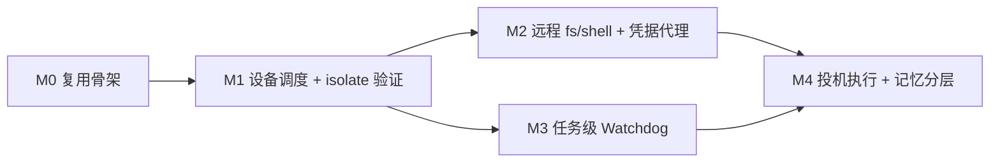

本文件未读

# 里程碑与验收标准

> 从 [20-design.md](20-design.md) 的设计拆出来的执行计划。
> 原则：**每个里程碑都能独立上线、独立回滚**，且不破坏原型已有的授权语义。

> **注意（2026-11-05 更新）**：本文的 M1–M4 是按 [20-design.md](20-design.md) 排的。
> 与 [40-decisions.md](40-decisions.md) 讨论后的定稿相比，有两处需要调整：
> 1. **M1 的"设备调度"优先级下调**——单机形态下不需要设备调度，它属于集群（见 [55-cluster.md](55-cluster.md)）；
> 2. **文件模型（[50](50-file-model.md) / [52](52-file-warden.md)）应插到 M1 之前**，因为它是单机就能落地、
>    且后续所有模块都依赖的基础（私有目录隔离、只追加日志、强制 git）。
>
> 建议的实际顺序：**M0 → M1'（文件模型 + 强制 git）→ M2'（凭据代理）→ M3（Watchdog）→ M1（集群化）→ M4**。

## 0. 总体策略

三条排序原则：

1. **先修安全，再修能力。** 凭据代理与执行平面是「能不能扩大范围」的前置条件；投机执行与长程记忆是「范围扩大后才有价值」的东西。
2. **先可观测，再自动化。** 每个模块的第一个版本都只观察不介入（沿用官方 `observe` 默认档的取向）。
3. **先单机，再跨设备。** 执行平面抽象先在单机把 seam 边界摸清（先用 stub 证明 `isolate` 可用），再引入 daemon。否则会一边迁移一边改协议。

M2 与 M3 可以并行——它们只共享 Engine 的 port，不互相阻塞。

## M0：复用官方骨架（2–3 周）

**目标**：把官方原型的领域层搬到本仓库，跑通「本地单机、单仓库」的等价能力，作为后续所有改动的基线。

| 工作项 | 产出 | 验收 |
| --- | --- | --- |
| 引入 `src/core` 原样复用 | 领域层 + 内存仓储 | `pnpm test` 里引擎测试全绿（对照官方 `core-engine.spec.ts`） |
| Store 换成可切换后端的 Repository 接口 | SQLite 实现 + 接口 | 两套实现跑同一份仓储测试 |
| 一个最小 Source（只读 GitHub 通知） | 能收 Trigger | 手工投一条 Issue 评论能走完 Gate → Eval → 忽略 |
| 一个最小 Executor（本机目录） | 能跑一个 Ticket | 端到端：评论 → 建 Ticket → 跑命令 → 回帖 |
| 面板最小页（Overview + Ticket 列表） | 能看、能 stop | 人能 stop 掉一个 Ticket 并看到 Mandate 被撤销 |

**明确不做**：多仓库、daemon、凭据、Watchdog、投机、记忆。

**风险**：官方原型依赖 `dsh 0.2.1-alpha.2`，本机是 `0.2.1-rc.5`。M0 的第一件事是**先跑通官方原型的 `pnpm check`**，确认版本可兼容；不兼容则在 M0 里做适配层。

---

## M1：设备调度 + `isolate` 验证（2 周）

**目标**：把「在哪儿跑」抽出来，单机仍然只有一个实现，但边界干净。
接入点是 dsh 已有的 `ctx.fs` / `ctx.shell` seam，不是自造转发层（理由见设计文档 §3.1.2）。

**交付**

- `DeviceDirectory` 端口与 `DeviceDescriptor` / `DeviceState` / `ExecutionMode` 类型；
- `local-session` 档位：本机 `ctx.fs` / `ctx.shell` 保持现状，只把目录与垫片逻辑从 `DshExecutor` 抽出；
- `isolate` 验证：同一进程里 Router 与 Worker 使用不同 `fs`/`shell` 实现的能力证明（用两个 stub 实现即可）；
- 设备状态机（`registered → online → degraded → offline → draining`）；
- `workspace_binding` 表与「同一 Ticket 不换设备」的不变式；
- `device.*` 与 `execution.migrated` 领域事件。

**验收标准**

| # | 标准 | 验证方式 |
| --- | --- | --- |
| 1 | 删除设备调度实现后，`src/core` 无需任何改动即可编译 | 编译期检查（core 不 import app） |
| 2 | 同一进程里 Router 用本机 `ctx.shell`、Worker 用 stub 远程 `ctx.shell`，互不影响 | 集成测试（cordis `isolate` 语义） |
| 3 | 设备 `degraded` 时，进行中的 turn 不被打断，但新 launch 排队 | `runtime-concurrency` 风格的测试 |
| 4 | 设备 `offline` 时 Ticket 显示 `Working / queued`，不报错、不换设备 | 状态机测试 |
| 5 | 人为迁移设备后，新 Assignment 带恢复提示，且旧目录不被删除 | 端到端 |

**度量**：设备不可用期间，Ticket 的 `queued` 时长 P95 < 人工介入阈值（可配置，默认 30 分钟）。

---

## M2：端侧 daemon + 凭据代理（5–6 周）

**目标**：让 Agent Loop 可以在云端（或另一台机器）跑，而命令在端侧执行；且凭据不进模型上下文。

这是最长的一个里程碑，建议拆成三个可独立上线的子阶段。

### M2a：远程 `ctx.fs` / `ctx.shell` 实现与幂等重放（3 周）

**交付**：`FileSystem` 与 `ShellExecutor` 两个抽象基类的远程实现；
`fs.*` / `shell.*` 逐方法镜像的消息集；`daemon_request` 幂等表；断线重连后按 `requestSeq` 重放；
`artifact` 回传；`read_image` 的二进制回传路径。

**验收**

| # | 标准 |
| --- | --- |
| 1 | 远程档位下 `dsh-tool-fs` / `dsh-tool-bash` / `dsh-tool-fs-search` **源码零改动**即可工作 |
| 2 | `readBytes` 超 `maxBytes` 以 `FS_TOO_LARGE` 失败而不是截断 |
| 3 | `fs.resolve` 对不同路径到达同一文件返回相同 `targetKey`；`write` 的 `guard` 不匹配返回 `FS_STALE_VERSION` |
| 4 | `shell.execute` 的非零退出、超时、中止都 resolve 成带 `timedOut`/`aborted` 的结果，只有基础设施故障 reject |
| 5 | 输出增量读取：连续两次 `readOutput` 不重复输出（后台作业语义的前提） |
| 6 | daemon 断线 30 秒后重连，未确认的命令恰好执行一次（注入计数器验证） |
| 7 | daemon 崩溃重启后，控制面能判断「哪些命令已生效」，并在恢复提示里告知 Worker |
| 8 | 长时间输出经 `tool-result-pruner` 的 8192/4096/1024 口径裁剪，行为与本机档位一致 |

### M2b：设备调度与离线语义（1.5 周）

**交付**：`resolve(ticket)` 五级规则；离线排队；`WaitingForDevice` 状态；面板上的设备视图。

**验收**

| # | 标准 |
| --- | --- |
| 1 | 设备离线时，非环境步骤照常推进（读 PR、发总结），环境步骤入队不丢 |
| 2 | 设备上线后，排队的步骤按序重放且顺序与入队一致 |
| 3 | 恢复提示里明确列出「上次未确认的步骤数」，Worker 被要求先核对再重复对外动作 |

### M2c：凭据代理（1.5 周）

**交付**：`CapabilityHandle`、短时租约、金丝雀、三层脱敏、`secret_lease` 审计表。

**验收**

| # | 标准 |
| --- | --- |
| 1 | 模型上下文里搜索不到任何凭据原文（扫描整个 Session Log 的 `user`/`tool` 内容） |
| 2 | 故意让一条命令 `echo $GH_TOKEN`，输出被拦截，且记一条泄漏告警 |
| 3 | 故意 `cat ~/.config/gh/hosts.yml`，文件不在 daemon 可见路径内（或返回空） |
| 4 | 租约过期后同一个句柄不可再用，必须重新兑换 |
| 5 | 每次兑换都能在 `secret_lease` 里找到：句柄、命令、时间、金丝雀 |

**度量**：金丝雀命中数 = 0 是硬指标；任何一次命中都当作事故处理。

**风险与缓解**：daemon 以操作员身份运行，这是本设计的已知边界（见设计文档 §3.3.3）。可选加固：独立 OS 账号 + 容器，不在默认路径。

---

## M3：任务级 Watchdog（3–4 周）

**目标**：能回答「这个 Worker 在推进吗」，且误报率低到不会成为新噪音源。

### M3a：信号采集与规则层（1.5 周）

**交付**：四类信号（工件变化 / 副作用 / 轨迹结构 / 资源曲线）采集；`stalled()` 组合谓词；`watchdog_observation` 表。

**验收**

| # | 标准 |
| --- | --- |
| 1 | 正常长任务（连跑 20 分钟无工件变化，但每轮有新信息）**不**触发 |
| 2 | 构造的空转用例（同一文件改 5 次、无新工件）**必然**触发 |
| 3 | 规则层单次判定 < 50 ms，无模型调用 |
| 4 | 采集不修改任何领域状态（只读 Session Log 与 Store 读查询） |

### M3b：模型研判与分级介入（1.5 周）

**交付**：`L0–L4` 介入阶梯；打扰预算；精确率统计与自动降级；L4 提案人审。

**验收**

| # | 标准 |
| --- | --- |
| 1 | 默认部署下只产生 L0 记录，不打扰任何人 |
| 2 | 同一 Ticket 的 L1 最多 2 次、L2 最多 1 次，超过直接升级到人 |
| 3 | Watchdog 判定为「偏离」时，其依据能追溯到具体工件与轨迹事件（不是自由文本判断） |
| 4 | 精确率低于配置阈值时自动降级到 L0，并在面板显示降级原因 |
| 5 | Watchdog 无法修改主系统提示词与触发规则，只能提交提案 |

### M3c：误报回放集（1 周）

**交付**：一组标注过的历史轨迹（正常 / 空转 / 偏离），作为回归测试集。

**验收**：精确率 ≥ 0.8、召回率 ≥ 0.6 才算达标；不达标就继续只观察。

**这是本设计里最容易被低估的一项**：没有回放集，Watchdog 的阈值调参就是盲调。

---

## M4：投机执行 + 记忆分层（4 周，可拆）

### M4a：投机执行预算（2 周）

**交付**：`Speculation` 聚合、三轮预算、隔离区、提升与丢弃；`speculate-only` 默认档。

**验收**

| # | 标准 |
| --- | --- |
| 1 | 投机产物在任何情况下都不出现对外副作用（扫描 outbox 与 Source 写调用） |
| 2 | 三重预算任一超限立刻停止，且已产生的工件保留（可用于下轮） |
| 3 | 提升时产物移动到新 Ticket 的 workspace，Worker 开局收到「已有先前准备」提示 |
| 4 | 丢弃 = 删目录 + 取消 Session，不残留 `effect` 行 |
| 5 | `speculate-then-act` 档位必须显式开启，且只能开 PR 不能 merge |

**度量**：投机命中率（提升数 / 投机总数）。低于 20% 说明规则选得不对，应该收敛规则而不是加大预算。

### M4b：记忆分层与遗忘（2 周）

> **设计已于 2026-11-13 推翻重写**：原按时间远近分 L0–L3，现按「是否会被静默删除」分层。
> 详见 [20-design.md](20-design.md) §3.6。下面是按新版排的交付与验收。

**交付**：L0 不变量层（永久重注入）、L1 决策层（决定 + **否决** + 理由，只追加）、
L2 事实层（TTL + 证据）、L3 轨迹层（可丢）；`supersedes` 语义；压缩前抽 L1 的钩子。

**验收**

| # | 标准 |
| --- | --- |
| 1 | 每条记忆都有 `derivedFrom`，可回溯到 Session Log 坐标 |
| 2 | 记忆**从不**参与授权判断（代码层面：授权路径不 import 记忆模块） |
| 3 | **连续压缩 5 次后，L0 与 L1 条目一条不少** |
| 4 | **被否决的方案不会在压缩后被重新提出**（构造回放验证，本模块的核心价值） |
| 5 | L0/L1 **永不参与逐出**（代码强制，非文档约定） |
| 6 | 面板能显示每次压缩丢掉了哪些 seq 范围，人能看出模型忘了什么 |
| 7 | L1 注入的 token 成本 < 前缀的 5% |
| 8 | 删掉全部 L2/L3 后，已定决策的执行不受影响 |

**为什么第 4 条是核心**：它对治的正是"模型再次提出自己已否决的方案"这个真实故障——
本会话里我自己就推翻过三次设计，若不记录否决理由，下次会当作新想法重提。

---

## 5. 指标口径

沿用长文的思路：**系统级指标不该是单次任务成功率**。

| 指标 | 定义 | 目标（首版） |
| --- | --- | --- |
| 人的决定数 / 任务 | 一个 Ticket 从创建到结束，人需要做出决定的次数 | 越低越好；当前基线由 M0 实测 |
| p95 完成时间 | 从 Trigger 到结果送达 | 不劣于官方原型的 15.7 分钟（同等负载） |
| Router 决策数 | 每个 Ticket 平均经过 Router 的决策次数 | 去掉直通后不应上升（验证订阅仍然有效） |
| 空转检出精确率 | Watchdog 判「空转」中真正空转的比例 | ≥ 0.8 |
| 凭据泄漏次数 | 金丝雀命中数 | 0 |
| 记忆召回成功率 | 抽查旧任务能否被找回 | ≥ 0.9（90 天内） |
| **L0/L1 存活率** | 连续压缩 N 次后，不变量与决策条目的留存比例 | **100%**（任一丢失即缺陷） |
| **否决重提率** | 压缩后模型重新提出已被 `rejected` 方案的次数 | **0**（本模块核心指标） |
| **L1 注入成本** | 每个请求中 L0+L1 注入所占 token | < 前缀的 5% |
| 打扰率 | 每个 Ticket 平均打扰人的次数 | ≤ 1 |

## 6. 风险清单

| 风险 | 概率 | 影响 | 缓解 |
| --- | --- | --- | --- |
| dsh `rc` 破坏兼容导致 M0 延期 | 高 | 中 | 锁定 `0.2.1-rc.5`；只用 `ctx.*` 公开接缝；适配层隔离 |
| daemon 协议设计不足，后期大改 | 中 | 高 | M2a 先做幂等与重放两个最难的点；协议版本号从第一天就有 |
| Watchdog 精确率不达标 | 中 | 中 | 永远可降级到 L0；不达标就不开 L1+ |
| 投机执行成本失控 | 中 | 中 | 三重硬预算；命中率低于 20% 自动收敛规则 |
| 记忆污染导致错误决策 | 中 | 高 | 只派生 + 可追溯 + TTL + 永远不参与授权 |
| 团队规模小时过度设计 | 中 | 中 | M0/M1 之后做一次判断：如果单机单仓库够用，M2 之后全部推迟 |

最后一条最重要：**官方原型的判断是「不是所有场景都需要 Super-agent」**，
判断标准只有一条——是否存在人在不同渠道之间搬运上下文的工作。
本仓库的六个模块同样应该按这个标准裁剪，而不是全做。
