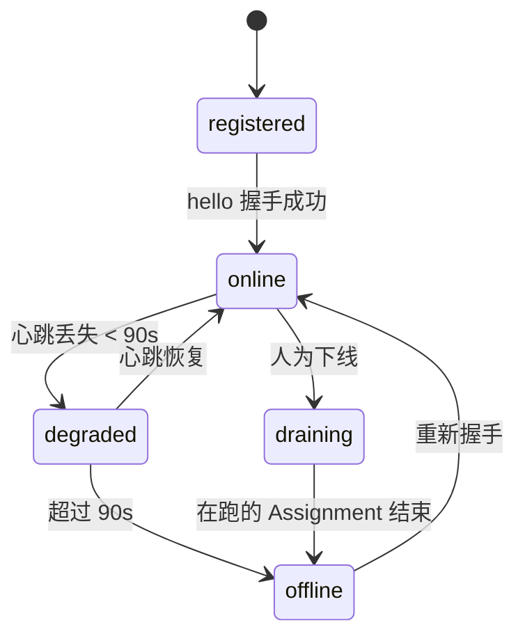

# 集群形态与 Relay

> 定稿依据：[40-decisions.md](40-decisions.md) 的 D5、D6、D18。
> 核心主张：**单机与集群是同一个系统的两种部署形态，不是两套代码。**
> 检验标准：集群化**不需要修改** [20-design.md](20-design.md) 的领域模型与 [50-file-model.md](50-file-model.md) 的文件模型。
> 如果集群要求改动它们，说明抽象错了。

## 1. 一个字段决定拓扑

设置页只有一个决定拓扑的字段：

| 配置 | 形态 | 会发生什么 |
| --- | --- | --- |
| `server` 为空（默认） | **单机** | 控制面 + 执行端在同一进程；不监听端口；无 relay |
| `server` 填了地址 | **集群** | 本节点连出去成为执行端；控制面在地址那台 |

服务端侧只需要一个开关让它开始监听（`listen`）。两者默认都空/关，**装上就是单机，填个地址才变集群**。

这符合 D3：**拓扑是部署时绑定的，不是运行时切换的**。切换拓扑 = 重启，和换模型、换预设是同一类决定。

### 为什么不做成"运行时模式切换"

一次会话的前缀在创建时就固定了。控制面从本地搬到远端，会改变 Worker 的工具实现、设备绑定、日志位置——**这正是 D2 说的"未开始对话时才能切换"的同一个理由**。

## 2. 三种角色，一套协议

```
        ┌──────────────────────────────────┐
        │  控制面（Control）                │
        │  Router + Engine + 文件调度者      │
        │  + 模型调用（key 池在这里）        │
        └───────────────┬──────────────────┘
                        │ 出站连接
                        ▼
        ┌──────────────────────────────────┐
        │  Relay（哑中继，可分层）           │
        │  只转发字节，不懂协议，不持状态     │
        └───────────────┬──────────────────┘
                        │ 由设备主动连上来
                        ▼
        ┌──────────────────────────────────┐
        │  执行端（Executor / daemon）       │
        │  ctx.fs + ctx.shell 的远程实现     │
        └──────────────────────────────────┘
```

**关键：三方都是出站连接。** 控制面不监听公网，设备不进 NAT 打洞，relay 不需要被信任。

| 角色 | 什么时候启用 | 有没有状态 |
| --- | --- | --- |
| Control | 服务端 | 有（Engine + SQLite） |
| Relay | 服务端，或任何中间节点 | **无** |
| Executor | 装了 daemon 的设备 | 只有设备本地事实 |

同一个二进制可以承担任意组合：`control`、`executor`、`control+executor`（即单机形态）、`relay`。

## 3. Relay 必须是哑的（D5）

| | 哑中继（本设计） | 智能中继（否决） |
| --- | --- | --- |
| 懂协议吗 | 不懂，按目标 id 转发帧 | 懂，参与调度 |
| 有状态吗 | 无 | 有 |
| 可以被信任的程度 | **不需要被信任** | 必须被信任 |
| 能不能用第三方 | 能（Cloudflare、Tailscale DERP） | 不能 |
| 故障影响 | 换一个即可 | 会长成第二个控制面 |

**选哑中继的核心理由是"不需要被信任"**：因为 payload 用端到端加密（见 §5），relay 只看到密文和对端 id。这直接决定了它可以跑在很便宜、甚至不属于自己的基础设施上——这是 [问题 3](40-decisions.md) 部署成本的第二重优化。

### 分层 relay（"中心服务器可以向下 relay"）

```
Control ──> Relay-A ──> Relay-B ──> Executor
（公网）     （办公网出口）  （实验室内网）
```

用途：

- **内网穿透**：LAN 里一台机器做 relay，其它机器不必各自连出去
- **带宽**：大工件走近端，不过公网
- **隐私**：整个内网只暴露一台

协议要支持链式转发，但**首版只支持一层**（中心即 relay）。差别只在"帧里带最终目标 id，中间节点按表转发"，链式是一层转发套一层，实现上是循环。

## 4. 协议：只加一层信封，不动内容

Relay 转发的是**不透明帧**：

```ts
/** Relay 能看到的全部。payload 是密文，relay 解不开。 */
interface Envelope {
  readonly to: NodeId          // 最终目标
  readonly from: NodeId        // 发起者（relay 只用于回程）
  readonly seq: number         // 端到端序号，relay 不解读
  readonly kind: 'fs' | 'shell' | 'control' | 'artifact' | 'heartbeat'
  readonly payload: Uint8Array // 密文
}
```

**注意 `to` 必须是最终目标，不是下一跳。** 下一跳由 relay 自己的路由表决定，与信封无关。这样链式 relay 不需要改信封。

### 与单机代码的关系

单机形态下，`fs` / `shell` 的实现直接调用本地；集群形态下，同一个实现把调用序列化后走 relay。**接口没变**（见 [50-file-model.md](50-file-model.md) 的 §6 对接点）。

```ts
// 同一个 RemoteFileSystem 类，两种传送方式
class TransportedFileSystem extends FileSystem {
  constructor(ctx, private readonly wire: Wire) { super(ctx) }
  async readText(target) { return this.wire.call('fs.readText', { target }) }
}

// 单机：Wire = 进程内直调
// 集群：Wire = 经 relay 的加密通道
```

## 5. 端到端加密：让 relay 无需被信任

```
Control ──[E2E: Ed25519 身份 + X25519 协商 + AEAD]──> Executor
                    ▲
                Relay 只转发密文
```

| 要素 | 做法 |
| --- | --- |
| 设备身份 | 首次加入时生成密钥对，公钥登记到控制面（`joinToken` 一次性授权） |
| 会话密钥 | 每次连接协商，前向保密 |
| 帧完整性 | AEAD（ChaCha20-Poly1305 或 AES-GCM） |
| 重放防护 | `seq` 单调 + 窗口 |
| relay 可见 | 只有 `to` / `from` / `kind` / 长度 |

**这解决了一个容易被忽略的问题**：如果把 relay 放在第三方（Cloudflare 等），没有 E2E 就等于把全部命令和输出交给了它。

而有了 E2E，relay 甚至可以是**你不拥有的机器**——这是把"部署成本"压到最低的一步。

### 一个推论

既然 relay 解不开 payload，**它也不可能做任何智能调度**。所以"哑"不是设计选择，是加密的必然结果。这两个决定互相加强。

## 6. 设备状态：两类事实分开上报（D6）

"连接时上报设备状态"要分成两半，因为它们的变化频率差三个数量级：

| 类型 | 内容 | 何时上报 | 存哪 |
| --- | --- | --- | --- |
| **能力清单**（慢变） | OS、工具链版本、workspace 根、内存总量、CPU 核数、可用外部目标 | **连接（hello）时一次** | `device` 表，一条记录 |
| **负载快照**（快变） | 当前空闲内存、运行中 worker、队列长度、是否电池供电、前台全屏应用 | **心跳持续追加** | `device_load` 表，追加行 |

**两者都是追加事实，没有一个需要"更新已有记录"**，完全落在 D3 里。

### 心跳间隔

家用路由 NAT 空闲超时常见 5–30 分钟。官方原型的 Watchdog 是**每小时一次**，这个频率撑不住任何长连接。

| 状态 | 间隔 | 理由 |
| --- | --- | --- |
| 空闲 | 20–30 秒 | 防止 NAT 掐断；电池设备可以放宽到 60 秒 |
| 有任务 | 10 秒 | 状态变化快，需要及时调度 |
| 断开后重连 | 指数退避 2s → 60s | 避免风暴 |

### 三态而不是两态

**连接断 ≠ 设备离线。** 因为 relay 是共享的，一次网络抖动会让**所有**设备同时"掉线"。所以必须有中间态：



| 状态 | 允许新 launch | 允许当前 turn 继续 |
| --- | --- | --- |
| online | 是 | 是 |
| **degraded** | **否** | **是**（关键：不能因为断连中断任务） |
| offline | 否（排队） | 不适用 |
| draining | 否 | 是（跑完为止） |

## 7. 集群让"部分失败"回来了——这是真实代价

单机形态最大的好处是**没有部分失败**：进程挂了是总失败，重启从 stored work 恢复，不存在"谁以为谁还活着"。

集群把这个复杂度**原样请回来**。必须补的机制：

| 机制 | 单机 | 集群 |
| --- | --- | --- |
| 幂等重放 | 不需要 | **必须**：`(device, seq)` 唯一 |
| 设备状态机 | 不需要 | 必须 |
| 心跳 | 不需要 | 必须 |
| 恢复提示 | 需要 | 需要，且更严格 |
| 半提交判定 | 只有"命令成功结果没回" | 加上"设备失联时命令在哪一步" |

### 恢复仍然靠外部真源

**恢复不靠"记住执行到哪"，靠"能从外部真源重新推断当前状态"。**

```
设备重连 → 上报最后完成的 seq
        → 控制面把 in-flight 标记为"结果未知"
        → 不自动重试
        → Worker 收到恢复提示："先检查目录、git 历史和 GitHub，再重复任何对外动作"
```

最后一句话直接来自官方原型，是这套恢复哲学最凝练的表述。

### 幂等性必须按操作类型标记

| 操作 | 幂等 | 崩溃后 |
| --- | --- | --- |
| `fs.stat` / `readText` | 是 | 自动重试 |
| `shell.execute`（只读命令） | 视命令 | 结果未知，交 Worker 核对 |
| `fs.write`（带版本号） | 是（CAS） | 自动重试，版本不匹配则拒 |
| `git push` / 发消息 / 开 PR | **否** | **必须核对，绝不自动重试** |
| `fs.write`（不带版本号，外部路径） | 否 | 交人 |

**把"这是否幂等"交给模型临场判断是不行的**——它不知道上次是否生效。必须是协议里的静态标记。

## 8. 失败模式：不做自动脑裂

服务器不可达时，设备怎么办？

| 方案 | 问题 |
| --- | --- |
| 自动降级为本地控制面 | **脑裂**：两边各自推进，状态分叉 |
| 完全停工 | 太严苛，用户无法继续 |
| **降级为只读 + 排队**（推荐） | 任务不丢；用户可显式选择"转本地" |

推荐做法：

1. 设备显示 `控制面不可达`
2. 已派工的任务继续跑完（本地执行不受影响）
3. 新任务排队，不丢
4. 用户可显式点"转本地运行"——**这是人的决定，不是自动的**，因为它会产生两条互不同步的历史

这与整套设计的立场一致：**冲突与不可逆的操作交给人，不做静默的自动决策。**

## 9. 单机/集群对照表

| 维度 | 单机 | 集群 |
| --- | --- | --- |
| 部署成本 | 零 | 一台 1C1G VPS（控制面 + relay 同机） |
| 持久在线 | 否（关机即停） | 是（控制面常驻） |
| 部分失败 | 无 | 有 |
| 需要的机制 | 少 | 幂等、状态机、心跳、恢复提示 |
| 模型调用位置 | 本地 | 控制面（key 池天然集中） |
| 执行位置 | 本地 | 各设备 |
| 文件模型 | **完全相同** | **完全相同** |
| 领域模型 | **完全相同** | **完全相同** |
| 迁移路径 | 填一个地址 | 清空地址 |

**这张表里最重要的一行是"完全相同"两行。** 它说明上面那一整套文件与领域设计不是只为单机做的。

## 10. 从单机演进到集群的顺序

不建议一次性上集群。按这个顺序，每步都可独立工作、可回滚：

| 步 | 做什么 | 验收 |
| --- | --- | --- |
| 1 | 把 `ctx.fs` / `ctx.shell` 的实现抽成"本地 Wire" | 单机行为完全不变 |
| 2 | 加一个"进程内 Wire"的第二种实现 | 两者可互换，测试覆盖同一套用例 |
| 3 | Wire 换成 TCP/WS（仍然同机） | 功能不变，但出现网络延迟 |
| 4 | 加 relay 转发 | 控制面与执行端分离到两台机器 |
| 5 | 加 E2E 加密 | relay 抓包看不到内容 |
| 6 | 加设备状态机与幂等重放 | 拔网线 30 秒，任务不丢、不重复 |

**第 2 步是分水岭**：如果两种 Wire 能共用同一套测试，说明抽象是对的；要改测试才能过，说明有东西漏在接口里了。

## 11. 待你决定的

| # | 问题 | 我的倾向 |
| --- | --- | --- |
| C1 | 首版要不要 E2E 加密？ | **要**。它是 relay 能被第三方托管的唯一前提；后加会改协议 |
| C2 | 首版支持几层 relay？ | **一层**（中心即 relay）。协议留好 `to` 字段，链式后加不改信封 |
| C3 | 服务器不可达时自动转本地？ | **不自动**。降级为只读+排队，转本地由人显式点 |
| C4 | 心跳间隔 | 空闲 20–30s，有任务 10s，电池设备放宽 |
| C5 | 设备加入的授权方式 | 一次性 `joinToken`（部署时生成），首次连接后换长期密钥 |
